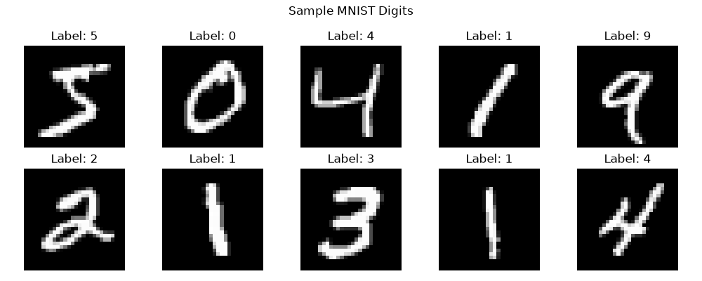
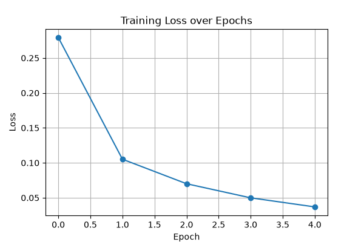
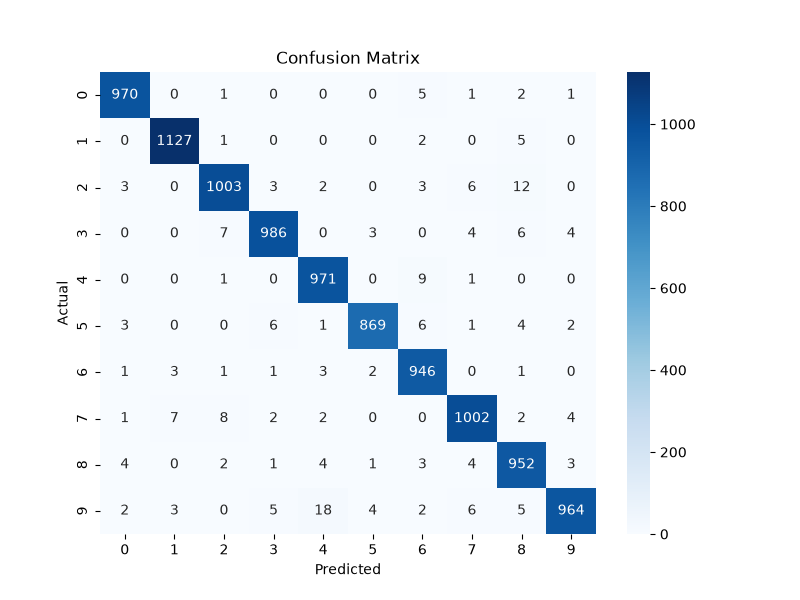
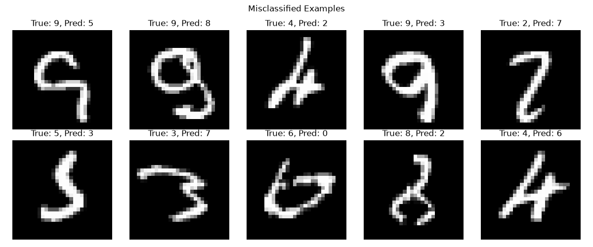
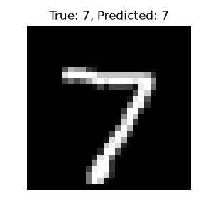

# MNIST Digit Classification using PyTorch MLP

A handwritten digit classification project built using PyTorch. The goal was to understand how a neural network learns from image data, train a model to recognize digits from 0 to 9, evaluate its performance, and investigate how changing the network architecture affects the results.

The project uses a **Multilayer Perceptron (MLP)**, a fully connected neural network, rather than a Convolutional Neural Network (CNN).

## Results at a Glance

| Metric | Result |
|---|---:|
| Best reported test accuracy | 97.68% |
| Training samples | 60,000 |
| Test samples | 10,000 |
| Input image size | 28 × 28 pixels |
| Output classes | 10 (digits 0–9) |
| Framework | PyTorch |

The 97.68% test accuracy was obtained with the `784 → 128 → 64 → 10` architecture over five epochs.

## Project Overview

MNIST contains grayscale images of handwritten digits, each measuring 28 × 28 pixels. The task is to predict which digit each image represents.

Instead of using a CNN, I started with a fully connected neural network to understand the fundamentals of deep learning: how input data moves through layers, how predictions are evaluated, and how the model's weights are updated during training.

After training the baseline model, I experimented with smaller, wider, and shallower architectures to compare their performance.

## Model Architecture

The baseline architecture is:

```text
Input image: 28 × 28 pixels
          |
       Flatten
          |
    784 input features
          |
    Linear: 784 → 128
          |
         ReLU
          |
     Linear: 128 → 64
          |
         ReLU
          |
     Linear: 64 → 10
          |
     10 class logits
          |
   Predicted digit (0–9)
```

### Why these layers?

- **Flatten:** Converts each 28 × 28 image into a vector containing 784 pixel values.
- **Linear layers:** Learn weights and biases that transform the input features into useful representations.
- **ReLU:** Introduces non-linearity, allowing the network to learn more than a single linear transformation.
- **Output layer:** Produces 10 raw logits, one for each digit class.
- **CrossEntropyLoss:** Compares the logits with the correct labels. It internally handles the log-softmax operation, so a separate softmax layer is not required during training.

The model learns by adjusting its weights and biases to reduce the classification loss.

## Training Configuration

| Parameter | Value |
|---|---|
| Framework | PyTorch |
| Optimizer | Adam |
| Learning rate | 0.001 |
| Loss function | CrossEntropyLoss |
| Batch size | 64 |
| Epochs | 5 |
| Hidden-layer activation | ReLU |
| Input preprocessing | `transforms.ToTensor()` |
| Device | CUDA when available, otherwise CPU |

`ToTensor()` converts the images into tensors and scales their pixel values to the range [0, 1].

The training DataLoader shuffles the training samples and processes them in batches of 64. The test DataLoader uses batches of 1,000 and does not shuffle the test set.

## Training Workflow

The training loop follows the standard PyTorch workflow:

1. **Load a batch:** Retrieve images and their correct labels from the DataLoader.
2. **Clear gradients:** `optimizer.zero_grad()` clears gradients from the previous update.
3. **Forward pass:** The images pass through the network to produce class logits.
4. **Calculate loss:** `CrossEntropyLoss` measures how well the predictions match the labels.
5. **Backpropagation:** `loss.backward()` calculates gradients using the chain rule.
6. **Update parameters:** `optimizer.step()` uses the gradients to update the model's learnable parameters.
7. **Repeat:** Continue for all batches and across all five epochs.

During evaluation, the model is switched to evaluation mode using `model.eval()`, and `torch.no_grad()` disables gradient tracking. Predictions are compared with the true labels to calculate test accuracy.

## Training Results

The following results are from the baseline run using CUDA.

| Epoch | Training Loss | Training Accuracy |
|---:|---:|---:|
| 1 | 0.3418 | 90.48% |
| 2 | 0.1428 | 95.81% |
| 3 | 0.0974 | 97.04% |
| 4 | 0.0721 | 97.80% |
| 5 | 0.0564 | 98.23% |

**Final test accuracy: 97.68%**

The training loss decreased across all five epochs, while training accuracy improved from 90.48% to 98.23%. The model also achieved 97.68% accuracy on the separate test set.

## Visualizations and Error Analysis

### Sample MNIST Digits

A sample of the dataset used to inspect the input images and their labels.



### Training Loss

The loss plot shows how the training loss changes over the five epochs.



### Confusion Matrix

The confusion matrix compares actual labels with predicted labels and helps identify which digit classes the model confuses.



### Misclassified Images

These examples show incorrectly classified test images, along with their true and predicted labels. Looking at individual mistakes helps identify cases that accuracy alone cannot explain.



### Single-Image Prediction

The script also performs inference on an individual test image and saves a visualization showing the true label and the predicted label.



In the recorded baseline run, the inference example had the true label `7`, and the model predicted `7`.

## Architecture Experiments

To investigate how network size and depth affect performance, I tested four MLP architectures while keeping the training setup at five epochs and using the same stated hyperparameters.

| Architecture | Training Accuracy | Test Accuracy | Final Training Loss |
|---|---:|---:|---:|
| `784 → 128 → 64 → 10` — Baseline | 98.23% | **97.68%** | 0.0564 |
| `784 → 64 → 32 → 10` — Smaller | 97.42% | 97.01% | 0.0851 |
| `784 → 256 → 128 → 10` — Wider | **98.73%** | 97.65% | **0.0385** |
| `784 → 128 → 10` — Shallower | 98.15% | 97.52% | 0.0640 |

Detailed epoch-by-epoch results are available in [`Different-architectures-NN01.md`](Different-architectures-NN01.md).

### What I observed

- **Smaller network:** The model with 64 and 32 neurons in its hidden layers achieved 97.01% test accuracy, lower than the baseline in this run.
- **Wider network:** Increasing the hidden-layer sizes to 256 and 128 produced the highest training accuracy and lowest training loss. However, its 97.65% test accuracy was almost identical to the baseline.
- **Shallower network:** Removing one hidden layer still produced 97.52% test accuracy, showing that a smaller-depth network can also learn useful representations of handwritten digits.
- **Baseline:** The `784 → 128 → 64 → 10` model achieved the highest test accuracy among these four recorded runs.

The baseline and wider model differed by only 0.03 percentage points in test accuracy. Since each architecture was tested in a single run, this comparison does not establish that the baseline is consistently better. Repeated runs with different random seeds would provide a more reliable comparison.

## What I Learned

This project helped me connect neural-network theory with an actual training workflow.

- **Tensors and input shapes:** Understanding how a batch of images is represented and why a 28 × 28 image becomes 784 input features.
- **Linear layers, weights and biases:** Understanding how `nn.Linear` connects neurons and introduces learnable parameters.
- **Activation functions:** Learning why ReLU is needed between hidden layers and how removing non-linear activations limits a network's ability to learn complex relationships.
- **Forward propagation:** Following the path from input images to output logits.
- **Loss functions:** Understanding how CrossEntropyLoss evaluates multi-class predictions.
- **Backpropagation:** Learning how `loss.backward()` calculates gradients that indicate how parameters should change.
- **Optimizers and learning rate:** Understanding how Adam uses gradients to update parameters and why the learning rate affects training.
- **Batches and epochs:** Understanding that a batch is a group of samples processed together, while an epoch represents one complete pass through the training dataset.
- **Training versus evaluation:** Understanding the difference between measuring performance on training data and evaluating generalization on unseen test data.
- **Model evaluation:** Interpreting accuracy, training loss, confusion matrices and individual misclassifications.
- **Architecture experimentation:** Comparing how the number of hidden layers and neurons affects training and test performance.

## Project Structure

```text
MNIST-Digit-Classification-MLP/
├── Project-NN-01.py
├── README.md
├── Different-architectures-NN01.md
├── Results.txt
├── mnist_mlp.pth
├── .gitignore
├── LICENSE
├── requirements.txt
└── images/
    ├── sample_digits.png
    ├── training_loss.png
    ├── confusion_matrix.png
    ├── misclassified.png
    └── single_prediction.png
```

The `data/` directory is created locally when MNIST is downloaded and is not required in the repository.

## Future Improvements

- Repeat the architecture experiments with multiple random seeds and compare mean test accuracy.
- Explore CNNs to learn how convolutional layers extract spatial features from images.
- Compare training time, parameter count and test accuracy across different architectures.
- Experiment with regularization and other hyperparameters to study their effect on generalization.

## Development Approach

AI tools were used to assist with implementation and troubleshooting. I used the project as a learning exercise to understand the neural-network training workflow, explain the purpose of the major components, inspect model predictions and test how architecture changes affected the measured results.

The focus was not only on obtaining a high accuracy score, but also on understanding the training process and learning how to evaluate a model beyond a single metric.
